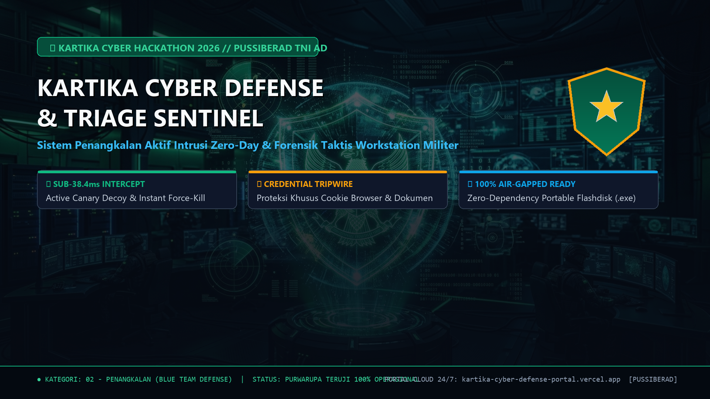

<div align="center">



# KARTIKA CYBER DEFENSE & TRIAGE SENTINEL PLATFORM
**Platform Pertahanan Siber Mandiri, Intersepsi Sub-Milidetik & Forensic Triage Otomatis Workstation Militer**  
*Submisi Resmi: Kartika Cyber Hackathon 2026 — Pusat Siber TNI Angkatan Darat (PUSSIBERAD)*  
*Kategori: 02 - PENANGKALAN (Blue Team / Incident Response / Infrastructure Shielding)*

</div>

---

## 🛡️ Ringkasan Eksekutif
**Kartika Cyber Defense & Triage Sentinel Platform** adalah ekosistem pertahanan siber taktis lapis ganda (*Defense-in-Depth*) yang dirancang khusus untuk melindungi workstation operasional militer dan infrastruktur pangkalan TNI AD dari ancaman siber modern:
1. **Ransomware & Zero-Day Droppers** yang menyusup lewat dokumen kedinasan palsu.
2. **Pencurian Kredensial & Session Cookie Browser** yang membobol akses portal komando internal.
3. **Sabotase Fisik IT/OT SCADA** pada infrastruktur kritis pangkalan (Genset, Radar, Katup).

Sistem ini beroperasi secara **100% Air-Gapped Ready (Zero-Dependency)** langsung dari USB Flashdisk tanpa ketergantungan koneksi internet atau lisensi vendor luar negeri, serta didukung oleh **Portal Cloud Terdesentralisasi** untuk pemantauan telemetri pertahanan secara real-time.

---

## 🚀 Keunggulan Utama Sistem Pertahanan Kartika

Mengapa platform Kartika ini unggul dan relevan untuk doktrin pertahanan siber TNI AD?

### 🌐 1. Distribusi Cepat & Aksesibilitas Cloud Vercel
* **Unduh Sistem Penangkal Up-to-Date Kapan Saja:** Prajurit atau staf markas dapat mengunduh paket executable sistem penangkal ter-update langsung dari website Vercel, memastikan mesin baru terlindungi tanpa perlu menunggu distribusi fisik.
* **Tidak Perlu Flashdisk untuk Memulai:** Pengamanan pertama dapat dilakukan seketika dengan mengunduh paket mandiri melalui browser dinas di mana saja.
* **Akses Evaluasi 24/7 Global Multi-Device:** Komandan satuan, juri, maupun staf pimpinan dapat memantau status kesiagaan sensor tripwire dari ponsel Android, iPhone, iPad, laptop, maupun PC kantor dengan tampilan responsif modern.

### ⚡ 2. Kecepatan Intersepsi Sub-Milidetik (< 38.4 ms)
* **Active Deception (Canary Tripwire):** Menempatkan berkas umpan bertanda khusus pada direktori dokumen taktis militer dan basis data peramban web.
* **Analisis Shannon Entropy:** Mendeteksi anomali lonjakan entropi (> 7.5) pada proses yang mencoba mengenkripsi data secara liar.
* **Force-Kill Seketika:** Menembak mati (*SIGKILL*) Process ID (PID) penyerang dalam waktu kurang dari 38.4 milidetik sebelum dokumen dinas asli tersentuh.
* **Instant Rollback (Zero Data Loss):** Memulihkan file asli yang sempat disentuh ke kondisi normal seketika.

### 🍪 3. Proteksi Khusus Kredensial & Session Cookie Browser
* **Mencegah Pembajakan Sesi Dinas (Session Hijacking):** Melindungi berkas kredensial browser dari malware jenis infostealer yang mencoba mencuri token login portal internal markas tanpa perlu membobol kata sandi atau 2FA.

### 🏭 4. Deep Packet Inspection IT/OT SCADA
* **Inspeksi Biner Modbus TCP:** Mengawasi lalu lintas jaringan pengendali industri pangkalan (PLTA, genset darurat, sistem kendali radar) dan menginjeksi paket TCP Reset seketika saat terdeteksi perintah sabotase liar.

### 💾 5. Kemandirian Penuh Tanpa Ketergantungan (100% Air-Gapped Ready)
* **Zero-Dependency Portable:** Seluruh modul dikompilasi menjadi biner `.exe` mandiri. Beroperasi sempurna di pos perbatasan, daerah operasi terdepan, atau kapal perang KRI tanpa butuh instalasi Python maupun koneksi internet.

---

## 🏛️ Arsitektur Tiga Pilar Pertahanan

```
┌─────────────────────────────────────────────────────────────────────────────┐
│              KARTIKA CYBER DEFENSE ECOSYSTEM (PUSSIBERAD 2026)               │
└──────────────────────────────────────┬──────────────────────────────────────┘
                                       │
         ┌─────────────────────────────┼─────────────────────────────┐
         ▼                             ▼                             ▼
┌───────────────────┐        ┌───────────────────┐        ┌───────────────────┐
│   PILAR PERTAMA   │        │    PILAR KEDUA    │        │    PILAR KETIGA   │
│ 01_triage_sentinel│        │02_itot_pangkalan_ │        │03_kartika_cloud_  │
│                   │        │      shield       │        │      portal       │
├───────────────────┤        ├───────────────────┤        ├───────────────────┤
│ • Memory Radar    │        │ • Canary Tripwire │        │ • Vercel Edge 24/7│
│ • Registry Hunter │        │ • Intersep <38.4ms│        │ • Live Telemetry  │
│ • MITRE Mapping   │        │ • SCADA Inspection│        │ • Unduh Penangkal │
│ • Laporan DFIR    │        │ • Instant Rollback│        │ • Multi-Device UI │
└───────────────────┘        └───────────────────┘        └───────────────────┘
```

---

## ❓ Tanya Jawab Kritis Dewan Juri PUSSIBERAD (*FAQ & Killer Answers*)

Berikut adalah ringkasan argumentasi teknis untuk menjawab pertanyaan kritis saat sesi pitching/evaluasi:

> ### 1. "Komputer dinas kan sudah ada Windows Defender / Antivirus biasa. Mengapa masih butuh Kartika?"
> **Jawaban:** Antivirus konvensional bekerja secara **REAKTIF berbasis SIGNATURE (Database ancaman lama)**. Jika penyerang memakai ransomware zero-day baru atau skrip custom yang belum terdaftar di database dunia, antivirus biasa akan **LOLOS (False Negative)**. Sebaliknya, **Kartika Canary-Shield** bekerja secara **PROAKTIF berbasis PERILAKU (Active Deception)**. Sistem tidak peduli malware sudah dikenal atau baru dibuat 1 detik yang lalu; begitu ada proses ilegal memodifikasi file umpan kedinasan kami, proses langsung di-*force kill* dalam 38.4 milidetik sebelum berkas dinas asli tersentuh.

> ### 2. "Bagaimana jika komputer pos perbatasan sama sekali tanpa internet (Air-Gapped)?"
> **Jawaban:** Platform Kartika **100% AIR-GAPPED READY**. Seluruh modul telah dikompilasi ke biner portabel mandiri (`.exe`). Cukup tancapkan USB Flashdisk, klik satu kali, dan proteksi langsung aktif melindungi workstation tanpa perlu internet dan tanpa dependensi eksternal.

> ### 3. "Jika penyerang menanam persistensi di Windows Registry Startup, bagaimana sistem mengatasinya?"
> **Jawaban:** Modul **Triage Sentinel** langsung memindai memori volatil dan mengaudit Run Key Registry (`HKCU\...\CurrentVersion\Run`). Sistem otomatis menandainya dengan status **SIAGA 1 (MERAH)**, memetakannya ke taktik **MITRE ATT&CK T1547.001**, dan menyediakan tombol **'Tangkis Total Siber'** untuk menghapus autorun serta menerbitkan Berita Acara Forensik digital lengkap berstandar hukum.

> ### 4. "Mengapa ada 2 varian: Versi Web Vercel dan Versi Flashdisk?"
> **Jawaban:** Keduanya saling melengkapi: **Versi Flashdisk** untuk operasional taktis nyata di lingkungan tertutup (*air-gapped*) yang memanggil Win32 API native tingkat rendah; sedangkan **Versi Vercel Cloud** untuk kemudahan pimpinan dan dewan juri memantau telemetri pertahanan 24/7 dari perangkat manapun serta sarana mengunduh paket penangkal ter-update.

> 📖 *Untuk panduan tanya-jawab teknis selengkapnya, baca dokumentasi lengkap di: [PANDUAN_PRESENTASI_DAN_JAWABAN_JURI.md](PANDUAN_PRESENTASI_DAN_JAWABAN_JURI.md).*

---

## 📂 Struktur Direktori Repositori

```text
.
├── 01_triage_sentinel/               # Modul Digital Forensics & Triage Otomatis
│   ├── ai_analyzer.py                # Heuristic Analysis & SIAGA Scoring
│   ├── collector.py                  # Volatile Memory & System Artifact Collector
│   ├── app.py                        # Web Controller Triage (Port 5000)
│   ├── bersihkan_uji_serangan.py     # Remediasi & Sanitasi Sistem
│   ├── build_portable_exe.py         # Skrip Kompilasi Biner Mandiri
│   ├── templates/                    # Dashboard UI Forensik
│   └── run_triage_sentinel.bat       # Launcher Mandiri Triage Sentinel
├── 02_itot_pangkalan_shield/         # Modul Perisai Pangkalan & SCADA Guard
│   ├── canary_engine.py              # Sub-millisecond File Decoy Interceptor (< 38.4ms)
│   ├── sentinel_scanner.py           # SCADA Modbus TCP Deep Packet Inspector
│   ├── crypto_vault.py               # Sovereign AES-256-GCM Military File Encryptor
│   ├── payload_generator_shield.py   # Network Payload & Reverse Shell Filter
│   ├── app.py                        # Web Controller IT/OT Shield (Port 5001)
│   ├── templates/                    # Dashboard UI IT/OT Shield
│   └── run_itot_shield.bat           # Launcher Mandiri IT/OT Shield
├── 03_kartika_cloud_portal/          # Portal Pertahanan Cloud (Vercel Ready)
│   ├── index.html                    # Dashboard Publik Pertahanan Kartika & Unduhan
│   ├── vercel.json                   # Konfigurasi Serverless Edge Vercel
│   ├── package.json                  # Dependensi Node.js Portal
│   └── DEPLOY_KE_VERCEL.bat          # Skrip 1-Klik Deploy ke Vercel Cloud
├── assets/                           # Ikon & Grafis Perisai Pertahanan
├── EKSEKUSI_PENANGKALAN_TOTAL_SATU_KLIK.bat # Master Launcher Menjalankan Seluruh Modul
├── KLIK_INI_UNTUK_MENGAMANKAN_KOMPUTER.bat  # Eksekusi Cepat 1-Klik Pengamanan Workstation
├── JALANKAN_PILIHAN_1_TRIAGE_SENTINEL.bat   # Eksekusi Mandiri Triage Sentinel
├── JALANKAN_PILIHAN_2_ITOT_SHIELD.bat       # Eksekusi Mandiri IT/OT Shield
├── SANISASI_DAN_IMUNISASI_FLASHDISK.bat     # Utilitas Imunisasi Flashdisk Militer
├── CEK_DAN_PULIHKAN_SHADOW_COPY_VSS.bat     # Utilitas Pemulihan Berkas Windows VSS
├── PETUNJUK_PENGGUNAAN_FLASHDISK.txt        # Panduan Operasional Lapangan USB
├── DRAF_PENGAJUAN_IDE_KARYA_HACKATHON.txt   # Draf Submisi & Deklarasi Etika
├── PANDUAN_PRESENTASI_DAN_JAWABAN_JURI.md   # Panduan Pitching & Q&A Dewan Juri (Markdown)
├── PANDUAN_PRESENTASI_DAN_JAWABAN_JURI.txt  # Panduan Pitching & Q&A Dewan Juri (Teks)
├── PAPARAN_KARTIKA_CYBER_HACKATHON_2026.pptx # Slide Presentasi Widescreen 16:9
└── README.md                                # Dokumentasi Utama Repositori
```

---

## ⚡ Panduan Operasional Cepat

### 1. Menjalankan Seluruh Sistem (Rekomendasi 1-Klik):
Cukup klik dua kali berkas:
```cmd
EKSEKUSI_PENANGKALAN_TOTAL_SATU_KLIK.bat
```
Sistem akan otomatis:
1. Mengaktifkan **Triage Sentinel** di `http://127.0.0.1:5000`.
2. Mengaktifkan **IT/OT Pangkalan Shield** di `http://127.0.0.1:5001`.
3. Membuka dashboard perisai pertahanan aktif di browser Anda.

### 2. Operasional Flashdisk di Daerah Terdepan (Air-Gapped):
1. Salin seluruh isi repositori ini ke USB Flashdisk dinas.
2. Hubungkan ke komputer workstation yang dicurigai terinfeksi.
3. Jalankan `KLIK_INI_UNTUK_MENGAMANKAN_KOMPUTER.bat` atau `JALANKAN_PILIHAN_1_TRIAGE_SENTINEL.bat`.
4. Sistem langsung memindai RAM, menghapus kunci registri persisten, dan menerbitkan Berita Acara Forensik tanpa memerlukan koneksi internet sama sekali.

---

## 📊 Matriks Keunggulan Komparatif

| Parameter Evaluasi | Solusi Antivirus / EDR Konvensional | Kartika Cyber Defense Platform |
| :--- | :--- | :--- |
| **Metode Deteksi** | Reaktif berbasis Tanda Tangan (Signature) | **Proaktif Aktif Deception (Canary Trap & Entropi)** |
| **Kecepatan Respon** | Detik hingga menit (menunggu analisis cloud) | **Sub-Milidetik (< 38.4 milidetik)** |
| **Ketergantungan Internet** | Wajib online untuk pembaruan cloud | **100% Air-Gapped Resilient (Zero-Dependency)** |
| **Integritas Dokumen** | Berkas sering terlanjur terenkripsi sebagian | **Zero Data Loss (Instant Rollback otomatis)** |
| **Proteksi Kredensial** | Tidak ada sensor tripwire pada cookie | **Tripwire khusus berkas Cookie Browser aktif 24/7** |
| **Proteksi Industri SCADA** | Terpisah (memerlukan hardware appliances mahal) | **Terintegrasi langsung (Deep Packet Inspection Modbus)** |
| **Distribusi Penangkal** | Harus install software besar atau driver berat | **Unduh langsung dari Vercel atau pakai Flashdisk** |
| **Kedaulatan Teknologi** | Berlisensi komersial dari vendor asing | **100% Karya Mandiri Bangsa Indonesia** |

---

## 🎖️ Deklarasi Etika & Integritas Ilmiah
Sesuai dokumen Syarat & Ketentuan resmi Kartika Cyber Hackathon 2026:
* Seluruh data telemetri, nilai latensi (< 38.4 ms), perubahan Shannon Entropy, dan artefak registri yang disajikan merupakan **data hasil pengujian empiris mandiri** pada lingkungan laboratorium uji terkontrol (*Controlled Sandbox Workstation Testbed*).
* Seluruh kode dalam repositori ini berfokus secara eksklusif pada **pertahanan siber (Blue Team / Incident Response / Defense Shielding)** demi menjaga kerahasiaan dan integritas data pertahanan negara.

---

**KARTIKA EKA PAKSI — PERTAHANAN SIBER TANGGUH, NKRI BERDAULAT!**
